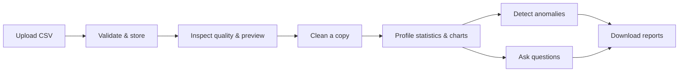
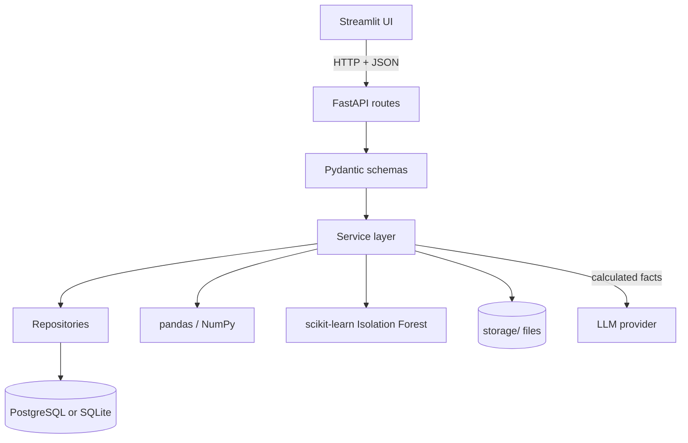
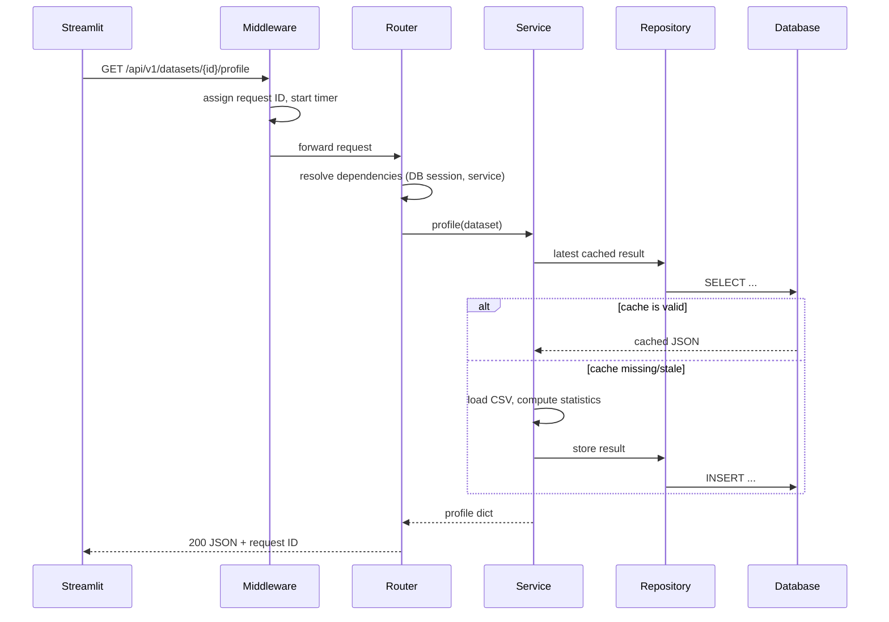
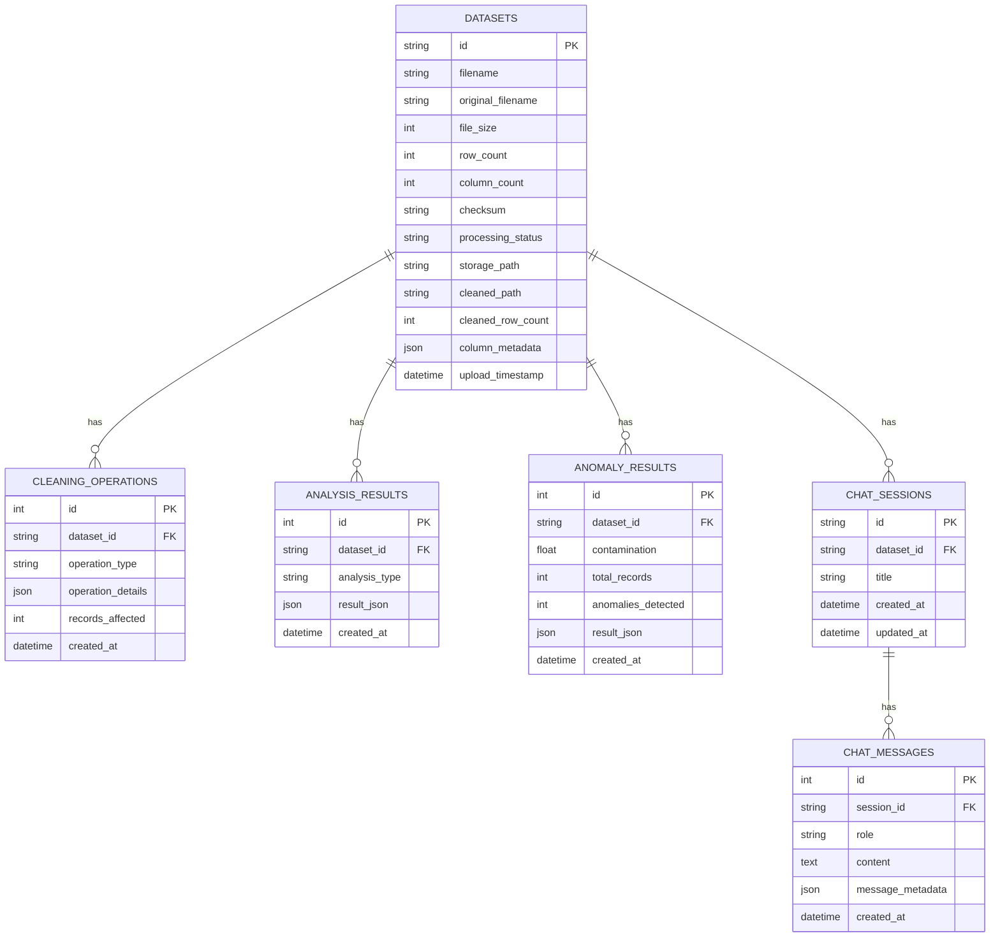
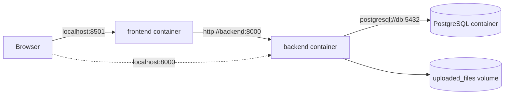

# InsightFlow: The Complete Beginner's Guide

> **Who this is for:** someone who knows a little Python (or none) and has heard of AI/ML, but wants to understand *everything* in this project without hand-waving.
>
> **What this guide is not:** a replacement for the README (setup), `docs/architecture.md` (engineering decisions) or `docs/api.md` (endpoint reference). It is the “explain it like I’m new” layer that connects all of them.

---

## Contents

1. [The one-paragraph explanation](#1-the-one-paragraph-explanation)
2. [The problem InsightFlow solves](#2-the-problem-insightflow-solves)
3. [The big picture](#3-the-big-picture)
4. [Absolute basics: files, data, HTTP and JSON](#4-absolute-basics-files-data-http-and-json)
5. [Every technology in the stack, and why it exists](#5-every-technology-in-the-stack-and-why-it-exists)
6. [How the backend is organised](#6-how-the-backend-is-organised)
7. [Databases explained from zero](#7-databases-explained-from-zero)
8. [Ingestion: from CSV bytes to a trustworthy table](#8-ingestion-from-csv-bytes-to-a-trustworthy-table)
9. [Cleaning: transformation with an audit trail](#9-cleaning-transformation-with-an-audit-trail)
10. [Statistics and EDA for beginners](#10-statistics-and-eda-for-beginners)
11. [Machine learning and anomaly detection](#11-machine-learning-and-anomaly-detection)
12. [Large language models without the hype](#12-large-language-models-without-the-hype)
13. [The frontend explained](#13-the-frontend-explained)
14. [Security and reliability](#14-security-and-reliability)
15. [Testing: how we know it works](#15-testing-how-we-know-it-works)
16. [Docker and deployment](#16-docker-and-deployment)
17. [A tour of every important file](#17-a-tour-of-every-important-file)
18. [Configuration reference](#18-configuration-reference)
19. [How to run and inspect everything](#19-how-to-run-and-inspect-everything)
20. [Worked examples: reading real responses](#20-worked-examples-reading-real-responses)
21. [Glossary](#21-glossary)
22. [FAQ and common confusions](#22-faq-and-common-confusions)
23. [Exercises to deepen your understanding](#23-exercises-to-deepen-your-understanding)

---

## 1. The one-paragraph explanation

InsightFlow is a small analytics product. A user uploads a CSV file (a table of data, like a spreadsheet export). The backend checks the file, stores it safely, computes statistics, lets the user clean a copy of the data, finds statistically unusual rows with a machine-learning algorithm called **Isolation Forest**, and lets the user ask questions in plain English. A language model can explain the results, but **every number is calculated by Python/pandas first**, so the AI cannot invent figures. A Streamlit web app presents all of this by calling a FastAPI REST API; PostgreSQL stores the metadata and history.

---

## 2. The problem InsightFlow solves

Imagine a marketing manager with `sales.csv`:

| transaction_id | transaction_date | product | category | quantity | unit_price | revenue |
|---|---|---|---|---|---|---|
| TXN-1 | 2024-01-02 | USB-C Dock | Electronics | 2 | 150.00 | 300.00 |
| TXN-2 | 2024-01-03 | Yoga Mat | Sports | 1 | 35.00 | 35.00 |
| TXN-3 | 2024-01-03 | 4K Monitor | Electronics | 1 | 420.00 | 420.00 |

They want to know:

- Is the file complete and trustworthy?
- Which categories make the most money?
- Are there missing values or duplicates?
- Which transactions look unusual?
- What is the average order value?
- Can I ask these questions without writing Python or SQL?

A spreadsheet can do some of this, but it does not give a reproducible pipeline, anomaly detection, an API, persistent history, or a grounded natural-language assistant. InsightFlow packages those pieces into one small, inspectable application.

The project is deliberately **single-user and local**. It does not pretend to have authentication, multi-tenancy, or production-scale infrastructure.

---

## 3. The big picture

### 3.1 The user journey



### 3.2 The technical layers



Two rules make the architecture easy to reason about:

1. **The frontend never touches the database.** It only calls the REST API.
2. **Routes are thin.** Validation and HTTP live in routes/schemas; business logic lives in services; database queries live in repositories.

### 3.3 What “dataset” means here

A dataset is not the CSV bytes in the database. It is a row in the `datasets` table plus two possible files:

- the **original upload** in `storage/uploads/`, never modified;
- an optional **cleaned copy** in `storage/processed/`.

When a cleaned copy exists, analytics, anomaly detection and the assistant use it. The original remains available and is the starting point for every new cleaning recipe.

---

## 4. Absolute basics: files, data, HTTP and JSON

### 4.1 CSV

**CSV** stands for *comma-separated values*. It is plain text:

```csv
name,age,city
Alice,30,London
Bob,,Paris
```

- The first line is the **header** (column names).
- Each following line is a **row** (record).
- Empty text between commas usually means a **missing value**.
- CSV has no types. `"30"` is text until a program decides it is a number.
- A file can use other delimiters (`;`, tabs), different encodings, and quoted fields containing commas.

InsightFlow accepts only `.csv`, sniffs common delimiters, and tries multiple text encodings.

### 4.2 Encoding

An **encoding** is the rule that maps bytes to characters. UTF-8 is the modern default; Windows exports often use `cp1252`; `latin-1` can read almost any byte sequence. InsightFlow tries `utf-8-sig`, `utf-8`, `cp1252`, then `latin-1`. Because `latin-1` accepts almost anything, the code also rejects binary files containing null bytes.

### 4.3 JSON

**JSON** is a text format for structured data:

```json
{
  "id": "8054...",
  "row_count": 759,
  "columns": ["revenue", "quantity"]
}
```

The API speaks JSON because it is language-independent and easy for the frontend to consume.

### 4.4 HTTP and REST

HTTP is the request/response protocol of the web.

- **Method**: `GET` reads, `POST` creates/acts, `DELETE` removes.
- **Path**: `/api/v1/datasets/{id}/profile`.
- **Status code**: `200` success, `201` created, `204` no content, `400` bad request, `404` not found, `413` too large, `415` wrong file type, `422` validation error, `500` server error, `503` service unavailable.
- **Headers**: metadata such as `Content-Type: application/json`.
- **Body**: the actual JSON or uploaded bytes.

**REST** is a convention for designing HTTP APIs around resources (`/datasets`, `/datasets/{id}/anomalies`). InsightFlow follows it consistently.

### 4.5 Multipart uploads

A normal JSON request cannot efficiently carry a file. The upload uses `multipart/form-data`, where the HTTP body contains the CSV bytes plus a filename and content type. FastAPI exposes this as an `UploadFile`.

### 4.6 API versus UI

The API is the product’s engine. The Streamlit UI is one client. You could write a different client (mobile app, script, notebook) without changing the backend. That separation is why the frontend lives in its own folder and imports no backend code.

### 4.7 Pagination and OpenAPI

**Pagination** avoids returning thousands of rows at once:

- `limit` = maximum items;
- `offset` = how many items to skip.

Dataset lists and previews use this pattern. The frontend keeps an offset in session state for the preview.

**OpenAPI** is a machine-readable description of the API. FastAPI generates it from routes, Pydantic schemas and type hints. Swagger UI at `/docs` is an interactive page generated from that description; it is always in sync with the code.

---

## 5. Every technology in the stack, and why it exists

| Technology | What it is | Why it is here |
|---|---|---|
| **Python 3.11** | Programming language | Clear data/ML ecosystem and readable code |
| **FastAPI** | Web framework for building APIs | Typed validation, automatic Swagger docs, dependency injection |
| **Uvicorn** | ASGI web server | Runs the FastAPI app |
| **Pydantic** | Data validation library | Rejects malformed requests and shapes responses |
| **SQLAlchemy 2.0** | ORM / SQL toolkit | Python objects instead of hand-written SQL; safe parameter binding |
| **Alembic** | Database migration tool | Versioned schema changes for PostgreSQL |
| **PostgreSQL** | Relational database | Robust production-style persistence, JSONB support |
| **SQLite** | File-based relational database | Zero-setup local/testing database |
| **pandas** | Tabular data library | Loading, cleaning, grouping, statistics |
| **NumPy** | Numerical arrays library | Fast math, histograms, numeric primitives |
| **scikit-learn** | Machine-learning library | Isolation Forest and StandardScaler |
| **HTTPX** | HTTP client | Calls OpenAI-compatible LLM APIs in tests/production |
| **Streamlit** | Python UI framework | Fast creation of interactive dashboards |
| **Plotly** | Interactive chart library | Histograms, heatmaps, trends and pie charts |
| **pytest** | Testing framework | Automated verification of every layer |
| **Docker / Compose** | Containerisation | Reproducible multi-service deployment |
| **Ruff** | Linter/formatter | Consistent code quality |
| **Git** | Version control | Incremental, reviewable history |

### 5.1 Python concepts used

- **Virtual environment**: `.venv/` isolates this project’s packages from the system Python.
- **`requirements.txt` vs `requirements-dev.txt`**: runtime dependencies vs extra test tooling. Installing the dev file includes the runtime file.
- **Type hints**: `def profile(dataset: Dataset) -> dict[str, Any]` documents types and helps editors find mistakes.
- **Dataclasses**: `QuestionResult` is a small container for a result and its facts.
- **Generators**: `get_db()` yields a database session and closes it after the request.
- **Context managers**: `with engine.connect()`, `with st.spinner(...)` manage setup/cleanup automatically.
- **Decorators**: `@field_validator`, `@property`, `@st.cache_data` attach behaviour to functions/fields.
- **f-strings**: string interpolation such as `f"{count:,} rows"`.
- **List/dict comprehensions**: compact transformations, e.g. turning ORM rows into response dictionaries.

### 5.2 Code quality and version control

- **PEP 8** is Python’s style guide. Ruff enforces imports, unused code and common bugs.
- **Ruff format** keeps whitespace/quotes consistent.
- **Docstrings** explain public functions/classes.
- **Git** records changes in commits. `.gitignore` prevents `.env`, `.venv`, databases and uploaded files from being committed.
- **API versioning** (`/api/v1`) leaves room for a future breaking API without silently changing clients.

---

## 6. How the backend is organised

### 6.1 A request’s life



### 6.2 The layers and their rules

| Layer | Folder | Allowed to do | Not allowed to do |
|---|---|---|---|
| Router | `app/api/routes/` | HTTP status, dependencies, call a service | Heavy math, raw SQL |
| Schema | `app/schemas/` | Validate input, shape output | Database access |
| Service | `app/services/` | All business logic and orchestration | Build HTTP responses |
| Repository | `app/repositories/` | Query/persist via SQLAlchemy | Cleaning/ML logic |
| Model | `app/models/` | Define tables and relationships | Business rules |
| Utility | `app/utils/` | Validation, serialization, parsing | Talk to HTTP |

This separation makes each piece testable. For example, `AnalyticsService` can be tested without starting a web server, and an API test can run without knowing pandas internals.

### 6.3 Dependency injection

FastAPI’s `Depends()` creates the database session and services per request:

```python
def get_dataset(dataset_id: str, db: Session = Depends(get_db)) -> Dataset:
    return DatasetRepository(db).get_required(dataset_id)
```

Benefits:

- one session per request, closed automatically;
- tests can substitute dependencies;
- routes stay short and declarative.

### 6.4 App startup (`lifespan`)

At startup the app:

1. configures logging,
2. creates storage directories,
3. for SQLite, creates tables automatically,
4. logs the version and environment.

PostgreSQL does **not** auto-create tables; Alembic migrations are the source of truth there. This avoids silently diverging schemas in a real database.

### 6.5 Middleware and request IDs

Middleware wraps every request. InsightFlow’s middleware:

- reads or generates `X-Request-ID`;
- stores it on `request.state`;
- times the request;
- adds the ID to the response header;
- logs method, path, status and duration.

Request IDs let you correlate a user-visible error with a server log line without exposing stack traces.

### 6.6 Exception handling

Expected errors raise `AppError` subclasses (`NotFoundError`, `ValidationAppError`, `FileTooLargeError`, …). A central handler converts them into:

```json
{
  "error": {
    "code": "validation_error",
    "message": "Unknown request columns: nope.",
    "details": {"missing_columns": ["nope"]},
    "request_id": "…"
  }
}
```

Unexpected exceptions log a traceback server-side and return a generic `500` envelope. This is both a security and a usability decision.

### 6.7 Sync vs async

- Upload endpoint is `async` because it awaits file reads.
- Most endpoints are plain `def`; FastAPI runs them in a worker thread, so synchronous pandas/scikit-learn code does not block the event loop.
- The LLM client uses synchronous HTTPX. That is acceptable for this single-user MVP; a high-traffic version would use async or a job queue.

### 6.8 CORS

Browsers block JavaScript from calling a different origin unless the server allows it. CORS middleware allows the Streamlit origin to call the API. `CORS_ORIGINS=*` is convenient locally; production should list explicit origins.

---

## 7. Databases explained from zero

### 7.1 The vocabulary

- **Table** = grid of data.
- **Row** = one record.
- **Column** = one field.
- **Primary key (PK)** = unique identifier for a row.
- **Foreign key (FK)** = a column pointing to another table’s PK.
- **Index** = lookup structure that speeds up reads.
- **Constraint** = rule (unique, not null, etc.).
- **Transaction** = a group of changes that either all succeed or all roll back.
- **ORM** = object-relational mapper: Python classes map to tables.
- **Migration** = a versioned script that changes the schema.

### 7.2 Why a relational database?

The project needs relationships: one dataset has many cleaning operations, analyses, anomaly runs and chat sessions. Relational databases enforce those links and let us query them reliably. They also give transactions, indexes and durable storage.

### 7.3 Tables in InsightFlow



**Design explanations**

- **String UUIDs** for datasets/sessions: globally unique, safe in URLs, no sequential guessing.
- **Auto-increment integers** for child records: simple ordering and IDs.
- **`ON DELETE CASCADE`**: deleting a dataset removes children automatically.
- **Indexes**: dataset status, `(dataset_id, analysis_type)`, anomaly timestamps and chat lookups are common filters.
- **JSON/JSONB** for flexible payloads: profile output and anomaly records have variable shapes, so forcing them into columns would be painful. PostgreSQL uses binary JSONB; SQLite uses JSON text.
- **No file bytes in the database**: files belong on disk; the DB stores paths and metadata. This keeps backups/queries fast and avoids bloating rows.

### 7.4 Transactions in practice

Services commit only after the complete operation succeeds:

```python
try:
    write_cleaned_file(...)
    record_operations(...)
    update_dataset(...)
    self.db.commit()
except Exception:
    self.db.rollback()
    delete_partial_file(...)
    raise
```

If the database fails after a file write, the file is removed. If the process crashes mid-write, files are written atomically via a temporary file plus `os.replace`.

### 7.5 SQLite versus PostgreSQL

| | SQLite | PostgreSQL |
|---|---|---|
| Setup | none; a file | server/container |
| Concurrency | limited writer | many clients |
| JSON | text JSON | JSONB |
| Use here | tests and quick local dev | Docker/deployment |
| Schema | auto-created on startup | Alembic migrations |

Both are supported through SQLAlchemy. The same models and queries work; only the JSON type and connection URL differ.

### 7.6 Why Alembic?

If you edit a Python model, the database does not change automatically. Alembic records schema versions:

```bash
alembic upgrade head
alembic revision --autogenerate -m "add column"
```

The Docker entrypoint retries `alembic upgrade head` until PostgreSQL is ready. This is why the container can start reliably even when the database is still booting.

### 7.7 SQLAlchemy sessions and connection pooling

A **session** is a short-lived unit of work: it tracks loaded objects, stages changes, and commits/rolls back. One session is created per request and always closed. A **connection pool** reuses database connections instead of reconnecting for every query. `pool_pre_ping=True` checks a pooled connection before use, which helps after a database restart.

### 7.8 Timestamps and time zones

Tables use timezone-aware timestamp columns with server-side defaults. PostgreSQL stores instants with timezone information; SQLite stores simpler timestamp text. The API serializes timestamps as ISO 8601 strings. When displaying times, remember that “naive” timestamps (without `Z`/offset) are not automatically converted to the browser’s local timezone.

---

## 8. Ingestion: from CSV bytes to a trustworthy table

### 8.1 The validation gates

Before anything is stored, `file_validation.py` checks:

1. **Extension** must be `.csv` (otherwise `415`).
2. **Size** must be under `MAX_UPLOAD_SIZE_MB` (otherwise `413`). The API reads in chunks and stops early.
3. **Not empty** (zero bytes → `400`).
4. **Not binary** (null bytes in the first 4 KB → `400`).
5. **Filename sanitised** (path components removed).
6. **Encoding** detected from the fallback list.
7. **Header** must exist, be non-empty, and have no blank names.
8. **Duplicate column names** are rejected *before* pandas can silently rename them.
9. **Rows** must be non-empty and under `MAX_DATASET_ROWS`.
10. **Parse errors** produce a clear validation error, not a stack trace.

### 8.2 Why duplicate columns matter

CSV:

```csv
price,price
10,20
```

Pandas would quietly turn this into `price` and `price.1`. That is dangerous: downstream code may reference the wrong column. InsightFlow rejects it and tells the user which names are duplicated.

### 8.3 Type inference

The file is initially read as text, then each column is inspected:

- If at least **95%** of non-null values convert to numbers, the column is numeric.
- A column is treated as datetime if its **name suggests time** (`date`, `day`, `month`, `year`, `timestamp`, …) **or** its values match a common date pattern, and at least 95% parse.
- Otherwise it stays categorical text.

Why 95% rather than 100%? Real data contains a few bad cells. Keeping the column usable while converting bad cells to missing is more practical than discarding it. Cleaning can then report or fix those invalid cells.

### 8.4 Metadata and quality metrics

For every column, the project records:

- name, pandas dtype, detected kind (numeric/categorical/datetime/boolean);
- missing count and percentage;
- number of unique non-null values;
- sample values.

The quality summary adds:

- total rows/columns, missing cells and missing percentage;
- exact duplicate row count;
- columns containing missing values.

These become the ingestion snapshot shown in the UI.

### 8.5 Safe storage

- A **UUID** is generated as the dataset ID.
- The stored filename is `<uuid>_<sanitized-name>`.
- Writes are atomic.
- A **SHA-256 checksum** is computed. SHA-256 is a one-way fingerprint: the same bytes produce the same hash, and accidental changes produce a different hash. It does not prove authorship; it detects corruption/duplication.
- The resolved file path must stay inside `STORAGE_DIR`. This blocks attempts like `../../etc/passwd`.

### 8.6 The upload response

The API returns the dataset metadata, quality summary and column info. Nothing is fabricated: the counts come from the actual parsed DataFrame.

---

## 9. Cleaning: transformation with an audit trail

### 9.1 The golden rule: originals are immutable

Cleaning never edits the uploaded file. It loads the original, transforms a **copy**, and writes a new processed file. This gives:

- reproducibility: running a new recipe starts from the same source;
- safety: a bad cleaning decision does not destroy data;
- auditability: the original checksum still matches.

### 9.2 Operation order (and why)

1. **Drop columns** — remove unwanted fields first.
2. **Convert types** — validate numbers/dates before strategies depend on them.
3. **Remove duplicates** — avoid counting duplicate rows in later statistics.
4. **Handle missing values** — using the chosen strategy.
5. **Handle outliers** — clip or remove rows based on numeric distributions.
6. **Normalise column names** — last, because the configuration uses the original names.
7. **Save the cleaned CSV atomically**.

### 9.3 Missing-value strategies

Suppose `revenue = [10, 20, None, 40]`.

| Strategy | Result | When to use |
|---|---|---|
| leave | `[10,20,None,40]` | missingness itself is meaningful |
| drop rows | `[10,20,40]` | few rows affected, completeness required |
| mean | `23.33` fills the gap | roughly symmetric numeric data |
| median | `20` fills the gap | numeric data with outliers; **more robust** than mean |
| mode | most frequent value | categorical data |
| constant | user-provided value | known default such as `0` or `"unknown"` |
| zero | `0` or `"0"` | counts where absence means zero |

Mean versus median: the mean is pulled by extreme values. In `[10,20,1000]`, the mean is 343 while the median is 20. For skewed revenue data, median imputation is usually safer.

The engine supports one global strategy plus per-column overrides. Non-numeric columns with `fill_mean`/`fill_median` produce warnings and are skipped rather than silently corrupting data.

### 9.4 Type conversion

The user can force a column to `numeric`, `datetime`, `string`, `category` or `boolean`.

Invalid values become missing, and the summary warns how many. For example, converting `["10", "20", "abc"]` to numeric yields `[10, 20, NaN]` plus a warning — not a crash.

### 9.5 Outliers with the IQR rule

The **interquartile range** is:

```text
IQR = Q3 − Q1
lower = Q1 − 1.5 × IQR
upper = Q3 + 1.5 × IQR
```

Example values: `1, 2, 3, 4, 100`.

- Q1 = 2, Q3 = 4, IQR = 2.
- Lower = −1, upper = 7.
- `100` is an outlier.

Actions:

- **clip**: replace values below/above the fence with the fence;
- **remove**: delete whole rows containing an outlier.

Important: outlier removal is a modelling choice, not a bug fix. A legitimate large sale can be removed if the threshold is too aggressive, which is why the UI configures it explicitly and records affected rows.

### 9.6 Duplicate removal

`drop_duplicates(keep="first")` removes exact duplicate rows across all columns. It does not detect near-duplicates (same customer, slightly different timestamp); that would require explicit business keys.

### 9.7 Column normalisation

`Total Revenue ($)` becomes `total_revenue` in snake_case:

- lowercase,
- non-alphanumeric runs become `_`,
- trim separators,
- resolve collisions with `_2`, `_3`.

This makes later API/column references predictable.

### 9.8 The summary and history

Every run returns:

- original/final rows and columns;
- missing before/after/filled;
- duplicates removed;
- transformed columns;
- operations with affected counts;
- warnings;
- before/after preview rows.

Each operation is also inserted into `cleaning_operations`, so history survives page reloads.

---

## 10. Statistics and EDA for beginners

EDA means **exploratory data analysis**: learning the shape of data before modelling.

### 10.1 DataFrame and Series

- A **DataFrame** is a table with named columns.
- A **Series** is one column.
- **Vectorised** operations apply to all values at once in optimised C code, which is why pandas is much faster than Python loops.

### 10.2 Numeric statistics

For a numeric column:

- **count**: non-null values.
- **mean**: sum ÷ count.
- **median**: middle value after sorting; robust to outliers.
- **standard deviation**: typical distance from the mean. Larger means more spread.
- **min/max**: extremes.
- **Q1/Q3**: 25th/75th percentile.
- **IQR**: Q3 − Q1.
- **skewness**: asymmetry. Positive means a long right tail.
- **outlier count**: values outside the 1.5×IQR fences.
- **missing percentage**: missing ÷ total rows.

These are computed with pandas and returned as JSON.

### 10.3 Missingness and cardinality

- **Missing percentage** shows incompleteness.
- **Unique count** measures cardinality.
- High cardinality (e.g. a customer ID with one value per row) is often an identifier, not a useful category.
- Low cardinality (e.g. five regions) is a good grouping dimension.

### 10.4 Categorical distributions

`value_counts()` counts occurrences. The UI shows the top values and their share of non-null records. This answers “which category is most common?” but not “which category earns the most?” — that requires grouping by a numeric metric.

### 10.5 Correlation

**Pearson correlation** measures the strength of a *linear* relationship between two numeric columns:

- `+1`: perfect positive line;
- `0`: no linear relationship;
- `−1`: perfect negative line.

It is not causation, and it misses non-linear patterns. The project calculates the matrix, prints the strongest pairs, and labels strength by absolute value:

| Absolute correlation | Label |
|---|---|
| ≥ 0.8 | very strong |
| ≥ 0.6 | strong |
| ≥ 0.4 | moderate |
| ≥ 0.2 | weak |
| < 0.2 | very weak |

Constant columns are excluded because correlation is undefined without variation.

### 10.6 Histograms

A histogram groups numeric values into **bins** and counts how many fall into each. InsightFlow uses 12 bins. Bin edges come from the actual minimum and maximum, so the chart reflects the data rather than hardcoded ranges.

### 10.7 Time series

When a datetime column exists, the profile builds a time series:

1. choose a date column (prefer names containing “date”);
2. choose a metric (prefer revenue/sales/amount/total/value, else the first numeric column);
3. use **daily** buckets if the span is ≤ 90 days, otherwise **monthly** (`resample("ME")`);
4. aggregate with sum for a metric (or count if there is no numeric metric);
5. keep periods that contain records.

This is aggregation, not forecasting. It shows what happened in each period.

### 10.8 Automated summary and quality issues

The profile produces a deterministic paragraph:

> “The dataset contains 750 rows and 9 columns (3 numeric, 5 categorical, 1 datetime). … The strongest correlation is …”

Quality issues are generated with explicit rules, for example:

- a column has ≥ 20% missing values;
- duplicate rows exist;
- a column has one constant value or is entirely empty;
- a numeric column has ≥ 2% IQR outliers;
- a categorical column has > 50 unique values and > 50% uniqueness ratio.

These are heuristics, not absolute truths.

### 10.9 Caching (and why profiles are fast the second time)

Computing a profile costs CPU. The result is stored in `analysis_results` with:

- `cache_version` (bump when the algorithm changes),
- `source_path`,
- source file modification time,
- the profile JSON.

A cached profile is reused only if path, mtime and version match. Cleaning writes a new file, so the old cache is automatically invalid. `refresh=true` forces recomputation.

**Tradeoff:** caching saves time but risks stale results if a file is changed outside the app without changing its mtime. The version/path/mtime check is a pragmatic compromise.

### 10.10 The chart types used

- **Histogram**: bins numeric values and counts them (distribution shape).
- **Box plot**: shows median, quartiles and whiskers. InsightFlow builds it from precomputed quartiles rather than sending raw rows to the browser.
- **Bar chart**: compares category counts or grouped totals.
- **Correlation heatmap**: a grid where colour/position represents the correlation between each numeric pair.
- **Line chart**: connects time-series points to show movement over time.
- **Donut chart**: shows the share of flagged vs normal records.
- **Horizontal severity bars**: rank the highest anomaly scores.

Chart data is computed by pandas and sent as numbers; Plotly only draws it.

---

## 11. Machine learning and anomaly detection

### 11.1 Supervised vs unsupervised learning

- **Supervised**: labels exist (`fraud = yes/no`), and the model learns from examples.
- **Unsupervised**: no labels; the model looks for structure.

InsightFlow has **no labels**, so it uses unsupervised anomaly detection. It cannot say “this is fraud”; it can say “this record is statistically unusual relative to the others”.

### 11.2 Features

A **feature** is an input variable used by a model. Here, features are numeric columns such as `quantity`, `unit_price`, and `revenue`. Text columns are not used directly because Isolation Forest needs numbers.

Not every numeric column is eligible:

- it must contain at least one non-null value;
- it must have more than one distinct value (a constant feature contains no signal).

### 11.3 Why anomalies are hard

There is no single definition of “unusual”. A value can be unusual in one column but normal in context. Multivariate anomalies are combinations that look odd together (e.g. tiny quantity but enormous revenue).

### 11.4 Isolation Forest intuition

Isolation Forest is an ensemble of random trees.

1. Pick a random feature.
2. Pick a random split between that feature’s min and max.
3. Repeat until each point is isolated in its own leaf.
4. **Anomalies tend to be isolated in fewer splits** because they sit apart from the dense crowd.
5. Normal points require more splits to isolate.

The model’s **path length** becomes the anomaly score. Short average path → more anomalous.

It is unsupervised, fast, handles multiple features, and does not assume a particular distribution.

### 11.5 Contamination

`contamination` is the expected fraction of outliers, e.g. `0.05` = 5%. It influences the threshold used to label records. It is a **prior**, not a discovered fact. If you set 5% on clean data, the model will still flag roughly 5% as unusual.

### 11.6 Preprocessing pipeline

The service:

1. selects numeric features;
2. replaces `+inf`/`-inf` with missing;
3. excludes rows where **every** selected feature is missing;
4. fills remaining gaps with the column **median**;
5. fills any still-empty values with `0`;
6. standardises each feature:

```text
z = (x − mean) / standard_deviation
```

Standardisation puts features on comparable scales. Isolation Forest is tree-based and does not strictly require it, but it makes feature-deviation contributions interpretable and keeps the numeric pipeline consistent.

### 11.7 Training, prediction and scores

- `fit_predict(matrix)` trains the forest and returns `+1` (normal) or `−1` (anomaly).
- `decision_function(matrix)` returns a score where lower means more anomalous.
- InsightFlow negates it: `anomaly_score = −decision_function`, so **higher = more unusual**, which is more intuitive.
- Anomalies are sorted by descending score and ranked.

### 11.8 Feature contributions

The service standardises features, takes the absolute z-values of anomalous rows, and averages them per feature. Features with the largest average deviation are reported as the main contributors. This is a simple heuristic, not SHAP or causal attribution.

### 11.9 Reproducibility

`random_state=42` seeds the random number generator. With the same data and settings, runs produce the same results. Without a seed, results can vary slightly.

### 11.10 What we do **not** claim

- No accuracy/precision/recall, because there are no labels.
- No fraud/error conclusion.
- No causal explanation.
- No guarantee that a flagged row is bad.

The UI and API show a disclaimer on every anomaly result. This is an ethical and engineering requirement, not boilerplate.

### 11.11 Row numbers

`row_number = dataframe_index + 2`:

- +1 because the CSV header occupies line 1;
- +1 because Python indices are 0-based.

On a cleaned dataset, the number refers to the **cleaned copy**, not necessarily the original upload line. This matters if duplicates were removed or rows reordered.

### 11.12 Storage limits

The API stores up to 2,000 anomaly records per run and reports `anomalies_truncated`. This prevents one result from becoming an enormous JSON/database payload. The CSV export uses the stored subset.

### 11.13 In-sample scoring and evaluation

There is no train/test split: the model is fitted and scored on the same active records. That is normal for this kind of unsupervised outlier scan, but it means scores describe *relative unusualness within this dataset*, not how well the model would generalise to new data. To evaluate properly you would need labelled examples and a held-out set.

### 11.14 Outlier vs anomaly

- An **outlier** is often a single-variable statistical observation (e.g. far outside the IQR fences).
- An **anomaly** here is a multivariate pattern that Isolation Forest isolates quickly.
- Neither word means “error” or “fraud”. Both are prompts for investigation.

---

## 12. Large language models without the hype

### 12.1 What an LLM does

A large language model predicts the next **token** (roughly a word piece) given previous text. It is good at language, explanation and summarisation. It is **not** a calculator or database. Asking it to do arithmetic invites errors.

### 12.2 Tokens and context windows

- **Token**: a chunk of text; “InsightFlow” may be one or several tokens.
- **Context window**: maximum tokens the model can consider at once.
- **Cost/latency** grow with prompt/output size.

This is why the project never sends the full dataset. It sends compact summaries and a handful of result rows.

### 12.3 Chat message roles

- **system**: instructions and constraints.
- **user**: the question/context.
- **assistant**: the model’s reply.

The project builds a system prompt with strict rules, optional recent history, and a user message containing the question plus calculated facts.

### 12.4 Temperature and max tokens

- `temperature=0.2`: low randomness, more focused wording.
- `max_tokens=800`: cap on response length.

Neither parameter affects the calculated facts; they only shape the narrative.

### 12.5 Provider compatibility

The client calls:

```text
{LLM_BASE_URL}/chat/completions
```

with `Authorization: Bearer <LLM_API_KEY>`, a model name and messages. Any OpenAI-compatible endpoint works. The key is read from the environment and never logged or returned.

### 12.6 Hallucination and grounding

**Hallucination** is a confident but false model output. **Grounding** means supplying verified facts and instructing the model to use only them.

InsightFlow’s strongest defence is architectural:

1. compute the answer with pandas;
2. return the calculated answer and facts to the user;
3. optionally ask the LLM to explain those facts;
4. always label the AI portion as interpretation.

Even if the LLM writes something wrong, the deterministic figures remain visible and authoritative.

### 12.7 The deterministic question engine

`question_engine.py` is a rule-based planner. It does **not** use an LLM.

Examples of intent detection:

- “Which category has the highest revenue?” → grouped aggregation.
- “What is the average sales value?” → scalar mean; “sales” maps to the closest numeric column (`revenue`).
- “How many unique customers?” → distinct count.
- “Explain the correlation…” → Pearson pairs.
- “What are the trends?” → time-series aggregation.
- “Are there unusual patterns?” → IQR scan (plus the latest Isolation Forest summary).
- “Summarize for management.” → profile summary.
- Anything unmatched → explicit “unanswerable” message listing available columns.

Grouping heuristics:

- detect mentioned categorical and numeric columns;
- prefer a column after “by/per”;
- otherwise inspect the noun phrase after “which/what … has”;
- fall back to the lowest-cardinality categorical column;
- default aggregation is **sum** for groups and **mean** for scalar questions, unless “average/median/total/…” is explicit;
- “least/lowest” sorts ascending, otherwise descending.

This is intentionally simple and inspectable. It will not understand every possible phrasing; when it cannot, it says so rather than inventing an answer.

### 12.8 Context sent to the provider

Only:

- dataset row/column counts;
- up to 40 column summaries (name, type, missing %, unique count);
- the profile summary and a few quality issues;
- top correlations;
- numeric highlights (mean/median/min/max);
- top category values;
- time-series metadata (not all points);
- latest anomaly summary;
- the calculated facts and at most 10 result rows;
- the last six conversation messages, truncated.

The serialized context is capped at 14,000 characters. The full dataset never leaves the server.

### 12.9 Output composition

```text
<deterministic pandas answer>

**AI interpretation:** <LLM explanation>
```

The API also returns:

- `mode`: `llm+calculations` or `calculations_only`;
- `calculated_facts`: label/value/method;
- `question_type`;
- `llm_error` and `note` when fallback occurs.

The frontend renders facts in a separate table and badges the mode.

### 12.10 Failure handling

| Failure | Behaviour |
|---|---|
| No API key | calculations-only + explanatory note |
| Timeout | terminate request, fall back |
| 429 rate limit | fall back with message |
| 401/403 auth | fall back; key never exposed |
| 5xx/network | fall back |
| malformed provider JSON | fall back |
| empty response | fall back |

A chat request still succeeds (`200`) because the deterministic answer is valid without the LLM.

### 12.11 Prompt injection

Dataset values and user text can contain instructions like “ignore previous rules.” The system prompt states that dataset values and conversation text are untrusted data, not instructions. More importantly, the LLM has no tools, no SQL access and no code execution, so a successful injection cannot alter the database or run code. It could only affect wording, while deterministic facts remain visible.

### 12.12 Is this RAG?

It is **RAG-like** in the broad sense: retrieve relevant computed facts, then generate language from them. It is **not** a vector-database RAG system. There are no embeddings or document chunks. For structured tabular data, deterministic retrieval/aggregation is more reliable and explainable.

### 12.13 Enabling a live provider

Set in `.env`:

```dotenv
LLM_API_KEY=sk-...
LLM_BASE_URL=https://api.openai.com/v1
LLM_MODEL=gpt-4o-mini
```

Then restart the backend. Without a key, the app is fully usable in calculations-only mode.

---

## 13. The frontend explained

### 13.1 Streamlit’s execution model

A Streamlit script runs **top to bottom on every interaction**. Clicking a button reruns the whole page script. Widgets return their current values on each run.

Consequences:

- state that must survive reruns lives in `st.session_state`;
- expensive calls should be cached (`st.cache_data` / `st.cache_resource`);
- pages are scripts under `frontend/pages/`.

### 13.2 Session state

Used for UI concerns only:

- `dataset_id` — active dataset;
- `chat_session_id` — active conversation;
- `anomaly_result` — latest anomaly payload for the session;
- `preview_offset` — pagination position;
- `uploaded_snapshot`, `cleaning_summary`, `pending_question`.

Switching datasets clears dataset-specific keys.

### 13.3 Navigation and shell

`app.py`:

- sets the page config and CSS;
- renders the logo, API status and global dataset selector;
- defines pages with `st.navigation` grouped into Workspace / Intelligence / Output;
- lets pages access the API client through a cached resource.

### 13.4 Components and design system

`components/ui.py` provides:

- metric cards, badges, callouts, empty states;
- formatting helpers (numbers, bytes, percentages, dates);
- `require_dataset()` which stops the page with a helpful empty state;
- HTML escaping for user-derived content.

`components/charts.py` builds Plotly figures from **already aggregated** API data. No page computes analytics locally.

### 13.5 Why Plotly?

Plotly renders interactive charts (hover, zoom, pan) as JavaScript, while Python builds the figure specification. The frontend sends no raw data to a chart library beyond the series returned by the API.

### 13.6 The API client

`services/api_client.py`:

- wraps every endpoint in a typed method;
- translates HTTP/network errors into `ApiError` with a user-readable message;
- handles timeouts (large profile requests can take time);
- downloads CSV bytes for buttons/links.

### 13.7 Page-by-page

| Page | What it shows | API calls |
|---|---|---|
| Overview | totals, recent activity, recent datasets | `/overview` |
| Datasets | upload, samples, library, schema, quality, preview, delete | upload/list/get/profile/preview/delete |
| Cleaning | recipe form, before/after, history | clean/history/get |
| Analytics | stats, histograms, box plots, categories, correlations, time series | profile/statistics |
| Anomalies | model form, summary, score charts, records, CSV | anomalies |
| Assistant | conversations, suggestions, messages, facts | chat/sessions/history |
| Reports | summary, quality/anomaly datasets, JSON report | report/downloads |

### 13.8 Why the frontend cannot access the database

Direct database access would:

- duplicate business rules;
- bypass API validation;
- make a future mobile/web client impossible;
- couple UI deployment to database credentials.

REST is the contract. The UI is replaceable.

---

## 14. Security and reliability

| Threat | Defence |
|---|---|
| Path traversal | basename sanitisation; resolved paths must sit under `STORAGE_DIR` |
| Huge uploads | chunked read + size limit (HTTP 413) |
| Binary/corrupt files | null-byte check, parse validation, domain errors |
| Duplicate headers | rejected before pandas renames them |
| SQL injection | SQLAlchemy bound parameters; no user-string SQL |
| XSS in UI | HTML-escaped summaries/issues/names; Plotly labels escaped |
| Secret leakage | `.env` ignored; keys never logged/returned |
| Stack traces | central handlers; generic 500 + request ID |
| LLM abuse | no code/SQL execution; facts-only context; untrusted-data instruction |
| Race with DB | transaction + rollback + file cleanup |
| Stale analytics | cache version + path + mtime |
| Unbounded outputs | preview pagination, top-N lists, anomaly cap |
| CORS | configurable origins |

**Not implemented (by design):** authentication, authorization, rate limiting per user, virus scanning, encryption at rest. This is a documented single-user local MVP.

---

## 15. Testing: how we know it works

### 15.1 Pytest basics

- A test is a function named `test_*`.
- Fixtures set up shared state (`client`, `db`, `uploaded`).
- Assertions check expected behaviour.
- Tests should be independent and repeatable.

### 15.2 Hermetic test environment

`conftest.py` sets environment variables **before importing the app**:

- temporary SQLite database;
- temporary storage directory;
- 2 MB upload limit;
- no LLM key.

Before each test, the schema is dropped and recreated and storage is cleaned. Tests do not touch your real data.

### 15.3 Layers tested

- **Ingestion**: valid/invalid/empty/oversized files, duplicate columns, traversal, encodings, previews.
- **Cleaning**: missing strategies, duplicates, conversion, outliers, normalisation, original preservation.
- **Analytics**: exact mean/median/quartiles, missing %, frequencies, correlation, time series, cache invalidation.
- **ML**: planted outliers, insufficient features, too few rows, exclusions, reproducibility, persistence.
- **API**: status codes, error envelopes, uploads, clean/profile/anomalies/chat/reports, deletes/cascades, overview.
- **LLM**: missing key, timeout, 429, 401, malformed responses, mocked success, grounding/fallback.
- **Question engine**: grouping, aliases, counts, correlation, trend, summary, unanswerable.
- **Config**: relative SQLite path anchoring, absolute paths, query preservation, directory creation.

### 15.4 Mocking the LLM

`httpx.MockTransport` intercepts HTTP calls and returns canned responses. This tests the real client logic (headers, parsing, error handling) without network access or cost. The assistant is also tested with a fake provider object to verify that deterministic facts and fallback notes are correct.

### 15.5 What tests do not prove

- statistical correctness on every possible dataset;
- LLM answer quality from a live provider;
- browser rendering aesthetics (verified separately with Playwright/screenshots);
- production-scale performance;
- security against every exotic attack.

Tests reduce risk; they are not a proof.

### 15.6 Running

```bash
cd backend
pytest
pytest --cov=app --cov-report=term-missing
```

Current suite: **91 tests**.

### 15.7 Linting, formatting and Git

- **Ruff check** catches unused imports, undefined names, import order and common bugs.
- **Ruff format** enforces consistent formatting.
- Git commits group related changes with an explanation. A clean `git status` means no accidental edits are uncommitted.
- CI (running lint + tests on every push) is listed as a future improvement; it is not configured yet.

---

## 16. Docker and deployment

### 16.1 Image versus container

- **Image**: a read-only blueprint (code + dependencies + command).
- **Container**: a running instance of an image.
- **Dockerfile**: instructions to build the image.
- **Compose**: definitions for multiple containers, networking and volumes.

### 16.2 Backend image

- base `python:3.11-slim`;
- install system `curl` for health checks;
- install Python dependencies;
- copy code;
- run as a non-root user;
- `ENTRYPOINT` waits/retries migrations, then executes Uvicorn;
- health check hits `/health`.

Docker builds in **layers**. Dependency installation is copied before application code so that changing a Python file does not reinstall every package; only later layers rebuild. `.dockerignore` keeps tests, local storage and secrets out of the build context.

### 16.3 Frontend image

- Python slim base;
- install Streamlit/Plotly/requests;
- copy the frontend;
- run Streamlit on `8501` as a non-root user;
- health check hits `/_stcore/health`.

### 16.4 Compose topology



- **Network**: Compose creates an internal network; service names resolve as hostnames (`backend`, `db`).
- **Volumes**: `postgres_data` keeps the database; `uploaded_files` keeps CSVs.
- **Bind mount**: `sample_data` is mounted read-only into the frontend for sample loading.
- **Depends on health**: the backend waits for Postgres; the frontend waits for the backend.
- **Ports**: host:container mapping. `8010:8000` means host port 8010 → container port 8000.
- **Environment variables**: injected at runtime; no secrets baked into images.

### 16.5 Why the frontend has two API URLs

Inside the Compose network, Streamlit must call `http://backend:8000`. A browser on the host cannot resolve `backend`, so download links must use `PUBLIC_API_BASE_URL` (e.g. `http://localhost:8000`). This distinction is easy to miss and explains many “downloads fail in Docker” bugs.

### 16.6 Migrations at startup

PostgreSQL containers start slower than Python. The entrypoint retries `alembic upgrade head` up to 30 times, then starts Uvicorn. This avoids a race where the API tries to query a table that does not exist yet.

### 16.7 SQLite versus Compose

- Local quick start: SQLite, schema auto-created.
- Compose: PostgreSQL, Alembic migrations.
- Tests: temporary SQLite.

The same services work because SQLAlchemy abstracts the differences.

---

## 17. A tour of every important file

### 17.1 Backend

| File | Why it exists |
|---|---|
| `backend/app/main.py` | App factory, middleware, routers, health, lifespan |
| `core/config.py` | Environment settings, path anchoring, SQLite URL normalisation |
| `core/logging.py` | Log format and third-party log levels |
| `core/exceptions.py` | Domain errors + consistent HTTP error envelopes |
| `db/base.py` | Declarative base, JSON/JSONB variant, timestamps |
| `db/session.py` | Engine, session factory, `get_db` dependency |
| `models/dataset.py` | Dataset table and relationships |
| `models/cleaning.py` | Cleaning operation records |
| `models/analysis.py` | Cached analyses and anomaly runs |
| `models/chat.py` | Sessions and messages |
| `schemas/dataset.py` | Upload, preview, cleaning contracts |
| `schemas/analytics.py` | Profile/statistics response shapes |
| `schemas/anomaly.py` | Anomaly request/response |
| `schemas/chat.py` | Chat request/response/history |
| `schemas/dashboard.py` | Overview metrics |
| `api/deps.py` | Dataset/service dependency providers |
| `api/routes/datasets.py` | Upload/list/detail/preview/delete |
| `api/routes/cleaning.py` | Clean + history |
| `api/routes/analytics.py` | Profile + statistics |
| `api/routes/anomalies.py` | Run/latest/history/specific |
| `api/routes/chat.py` | Ask/history/sessions |
| `api/routes/reports.py` | JSON report + CSV downloads |
| `api/routes/overview.py` | Dashboard aggregates |
| `repositories/*.py` | SQLAlchemy queries |
| `services/ingestion_service.py` | Validation, storage, metadata |
| `services/cleaning_service.py` | Cleaning engine and history |
| `services/analytics_service.py` | Profiling, stats, correlations, cache |
| `services/anomaly_service.py` | Isolation Forest pipeline |
| `services/question_engine.py` | Deterministic intent/calculation engine |
| `services/llm_service.py` | Provider HTTP client and prompts |
| `services/chat_service.py` | Orchestration, persistence, fallback |
| `services/report_service.py` | Consolidated report/CSV exports |
| `utils/file_validation.py` | Filename, size, encoding, CSV parsing |
| `utils/data_validation.py` | Column metadata, quality, safe loading, path checks |
| `utils/serialization.py` | JSON-safe conversion of NumPy/pandas values |
| `migrations/` | Alembic environment + initial schema |
| `tests/` | 91 automated tests |

### 17.2 Frontend

| File | Why it exists |
|---|---|
| `app.py` | Shell, styles, sidebar, navigation |
| `pages/overview.py` | Dashboard from `/overview` |
| `pages/datasets.py` | Upload/sample/library/details/preview/delete |
| `pages/cleaning.py` | Recipe form + before/after + history |
| `pages/analytics.py` | Stats/charts tabs |
| `pages/anomalies.py` | Model form + results + downloads |
| `pages/assistant.py` | Chat UI + facts |
| `pages/reports.py` | JSON report + exports |
| `components/ui.py` | Design system and formatting |
| `components/charts.py` | Plotly chart builders |
| `services/api_client.py` | Typed HTTP client |
| `services/__init__.py` | Cached client/health |
| `assets/logo.svg` | Logo |
| `.streamlit/config.toml` | Theme and upload limit |

### 17.3 Root

| Path | Why it exists |
|---|---|
| `sample_data/` | Reproducible sales/marketing CSVs |
| `scripts/generate_sample_data.py` | Sample generator (seed 42) |
| `scripts/capture_screenshots.py` | Playwright documentation capture |
| `docs/architecture.md` | Engineering decisions |
| `docs/api.md` | Endpoint reference |
| `docs/screenshots/` | Real UI captures |
| `docker-compose.yml` | Multi-service deployment |
| `.env.example` | Safe configuration template |
| `pyproject.toml` | Ruff configuration |
| `.gitignore` | Keeps secrets/data/venv out of Git |

---

## 18. Configuration reference

| Variable | Meaning | Safe default |
|---|---|---|
| `DATABASE_URL` | DB connection; relative SQLite paths anchor to repo root | SQLite file |
| `ENVIRONMENT` | Label (`development`, `test`) | `development` |
| `DEBUG` | Debug flag | `false` |
| `LOG_LEVEL` | Logging verbosity | `INFO` |
| `CORS_ORIGINS` | Allowed browser origins | `*` |
| `MAX_UPLOAD_SIZE_MB` | Upload limit | `25` |
| `MAX_DATASET_ROWS` | Row limit | `500000` |
| `STORAGE_DIR` | Root for files | `storage` |
| `UPLOAD_DIR` | Original files | `storage/uploads` |
| `PROCESSED_DIR` | Cleaned files | `storage/processed` |
| `LLM_API_KEY` | Provider key | empty → no LLM |
| `LLM_BASE_URL` | OpenAI-compatible base | OpenAI |
| `LLM_MODEL` | Model name | `gpt-4o-mini` |
| `LLM_TIMEOUT_SECONDS` | Request timeout | `30` |
| `LLM_MAX_TOKENS` | Output cap | `800` |
| `LLM_TEMPERATURE` | Randomness | `0.2` |
| `ANOMALY_CONTAMINATION` | Default expected outlier share | `0.05` |
| `ANOMALY_RANDOM_STATE` | Reproducibility seed | `42` |
| `API_BASE_URL` | Server-side frontend → API | `http://localhost:8000` |
| `PUBLIC_API_BASE_URL` | Browser-facing download URL | same |
| `BACKEND_PORT` | Host port for Compose backend | `8000` |
| `FRONTEND_PORT` | Host port for Compose frontend | `8501` |

---

## 19. How to run and inspect everything

### 19.1 Local SQLite

```bash
cp .env.example .env
# set DATABASE_URL=sqlite:///storage/insightflow.db

# terminal 1
cd backend
../.venv/bin/uvicorn app.main:app --reload --port 8000

# terminal 2
cd frontend
API_BASE_URL=http://localhost:8000 ../.venv/bin/streamlit run app.py
```

Relative SQLite paths are anchored to the repo root, so running from `backend/` is safe.

### 19.2 Docker with PostgreSQL

```bash
cp .env.example .env
docker compose up --build
```

If host ports are busy:

```bash
BACKEND_PORT=8010 FRONTEND_PORT=8502 \
PUBLIC_API_BASE_URL=http://localhost:8010 \
docker compose up --build
```

### 19.3 Inspect the API

- Swagger UI: `/docs`
- health: `/health`
- upload with curl:

```bash
curl -X POST http://localhost:8000/api/v1/datasets/upload \
  -F "file=@sample_data/sales.csv;type=text/csv"
```

### 19.4 Inspect the database

```bash
docker compose exec db psql -U insightflow -d insightflow
\dt
select id, original_filename, processing_status from datasets;
select * from cleaning_operations;
```

### 19.5 Tests

```bash
cd backend
pytest
```

### 19.6 Logs

```bash
docker compose logs -f backend
docker compose logs -f frontend
docker compose logs -f db
```

### 19.7 Sample data and reproducibility

`scripts/generate_sample_data.py` uses NumPy’s seeded random generator (`seed=42`) to create:

- 759 sales rows with deliberate missing values, 9 exact duplicates, multiple categories/regions and extreme orders;
- 420 marketing rows with channel-specific performance patterns and missing metrics.

A **random seed** makes “random” output repeatable: the same seed and code produce the same dataset. This matters for tests and demos. The script never hardcodes analytics results; it only generates raw rows. All statistics are computed later from those rows.

---

## 20. Worked examples: reading real responses

### 20.1 Upload

```json
{
  "dataset": {"id": "8054...", "row_count": 759, "column_count": 9},
  "quality": {"missing_cells": 76, "duplicate_rows": 9},
  "columns": [
    {"name": "revenue", "kind": "numeric", "missing_count": 15}
  ]
}
```

Meaning: 759 rows parsed, 9 exact duplicate rows, 76 missing cells; `revenue` is numeric with 15 missing values.

### 20.2 Cleaning

```json
{
  "original_row_count": 759,
  "final_row_count": 750,
  "duplicates_removed": 9,
  "missing_values_before": 76,
  "missing_values_after": 59,
  "missing_values_filled": 15,
  "warnings": []
}
```

Meaning: 9 duplicates removed; 15 numeric gaps filled; 59 gaps remain because non-numeric columns were not filled by the chosen strategy (or rows were dropped).

### 20.3 Anomaly run

```json
{
  "total_records": 750,
  "anomalies_detected": 38,
  "anomaly_percentage": 5.07,
  "features": ["quantity", "unit_price", "revenue"],
  "anomalies": [{"row_number": 679, "anomaly_score": 0.304986, "rank": 1}]
}
```

Meaning: 38 of 750 records are flagged at 5% contamination; row 679 is the highest-scoring anomaly across those three features.

### 20.4 Assistant

```json
{
  "answer": "By total revenue, the highest category is 'Electronics' at 400,586.77. …",
  "mode": "calculations_only",
  "calculated_facts": [
    {"label": "Top category by total revenue", "value": "Electronics (400,586.77)", "method": "pandas groupby ranking"}
  ],
  "note": "AI interpretation is unavailable because no LLM provider is configured."
}
```

Meaning: pandas computed the ranking; no AI narrative was added; the user still got a grounded answer.

---

## 21. Glossary

| Term | Plain-English meaning |
|---|---|
| **API** | Programmatic interface between systems |
| **ASGI** | Async Python web-server interface used by FastAPI |
| **Alembic** | Database schema migration tool |
| **Anomaly** | Statistically unusual record |
| **Categorical** | Text/groups rather than numbers |
| **Cardinality** | Number of distinct values |
| **Checksum** | Fingerprint of file bytes |
| **Contamination** | Expected fraction of anomalies |
| **CORS** | Browser cross-origin permission rules |
| **CSV** | Comma-separated values text table |
| **DataFrame** | pandas table |
| **Datetime** | Date/time value |
| **Dependency injection** | Framework supplies dependencies instead of code constructing them |
| **Docker image/container** | Blueprint / running instance |
| **Encoding** | Bytes ↔ characters rules |
| **Feature** | Model input variable |
| **Foreign key** | Column referencing another table’s primary key |
| **Grounding** | Restricting AI output to verified facts |
| **Hallucination** | Plausible but false AI text |
| **Histogram** | Binned count chart |
| **IQR** | Q3 − Q1, a robust spread measure |
| **Isolation Forest** | Tree ensemble that isolates anomalies quickly |
| **JSON/JSONB** | Structured text / binary JSON in PostgreSQL |
| **LLM** | Large language model |
| **Mean/median** | Arithmetic average / middle value |
| **Migration** | Versioned DB schema change |
| **Missing value** | Absent/null cell |
| **Mode** | Most frequent value |
| **ORM** | Python objects ↔ database tables |
| **Outlier** | Value far from the bulk of the data |
| **Pandas** | Python tabular data library |
| **Path traversal** | Attempt to access files outside allowed directory |
| **Pearson correlation** | Linear association between numeric variables |
| **Pipelines** | Ordered transformation steps |
| **Plotly** | Interactive charting library |
| **Primary key** | Unique row identifier |
| **Prompt** | Instructions/context given to an LLM |
| **Pydantic** | Python validation/serialization library |
| **Quantile/quartile** | Value below which a fraction of data falls |
| **RAG** | Retrieve facts then generate text |
| **Regression / classification** | Supervised prediction types (not used here) |
| **Repository pattern** | Isolates database queries |
| **REST** | Resource-oriented HTTP API style |
| **Row number** | CSV position including header |
| **SHA-256** | Cryptographic hash function |
| **SQL injection** | Malicious SQL via unsanitised input |
| **StandardScaler/standardisation** | Rescale to mean 0, std 1 |
| **Streamlit** | Python UI framework |
| **Token** | LLM text unit |
| **Transaction** | All-or-nothing DB change group |
| **UUID** | Globally unique identifier |
| **Vectorisation** | Array-wide operations instead of loops |
| **XSS** | Injecting executable HTML/JS into a page |

---

## 22. FAQ and common confusions

**Why not let the LLM calculate the answer?**
Language models are not reliable calculators. Pandas gives deterministic, testable numbers. The LLM is used for explanation only.

**Does the LLM see my whole CSV?**
No. It sees column summaries, profile highlights and the specific calculated facts/table rows needed for the question.

**Why is there no model accuracy?**
Accuracy requires labelled ground truth. This is unsupervised detection. Reporting “accuracy” would be misleading.

**Why can cleaning produce 0 anomalies after clipping?**
Clipping changes the numeric distribution, so extreme values are no longer extreme. Anomaly detection runs on the active (cleaned) version.

**Why did my row number not match the original file?**
After cleaning, row numbers refer to the cleaned copy. Duplicates/removals shift positions.

**Why are duplicates rejected at ingestion?**
Duplicate column names cause silent ambiguity. Rejecting early is safer than guessing.

**Why use median instead of mean for missing numeric values?**
The median is less sensitive to extreme values. The choice is still configurable.

**Why not just drop every row with a missing value?**
That can remove a large fraction of the dataset and bias the analysis. The strategy is a user decision.

**Why cache profiles?**
Statistical profiling is CPU-heavy. Caching makes repeat views fast; path + mtime + version checks prevent most staleness.

**Why store JSON in the database if this is relational?**
The flexible parts (profiles, anomaly payloads) change shape often. JSON avoids dozens of sparse columns, while query-critical metadata remains typed columns.

**Why not store files in PostgreSQL?**
Large binaries bloat backups and queries. A controlled filesystem plus metadata is simpler for this MVP.

**Why two API URLs in Docker?**
Containers talk to `backend:8000`; browsers need `localhost:8000` (or another published port). They are different networks.

**Why does the frontend not import backend models?**
That would create coupling and bypass validation. The API is the contract.

**Why is there no authentication?**
The spec explicitly defines a single-user local MVP. Adding fake auth would be worse than documenting the boundary. A future identity layer can attach owners to datasets.

**Why SQLite if PostgreSQL is required?**
PostgreSQL is the deployment target; SQLite is an optional lightweight local/test database. Both are supported deliberately.

**Does the assistant execute SQL or Python generated by the model?**
Never. The LLM has no tools and no database access in this architecture.

**What happens if the LLM provider is down?**
The user still gets the deterministic answer, a clear fallback note, and `mode=calculations_only`.

**How do I add a new aggregate question?**
Extend `QuestionEngine` with a new intent/method, add facts with methods, add tests, and let the same LLM explanation path handle it.

---

## 23. Exercises to deepen your understanding

1. Upload `sample_data/sales.csv`, clean it with median imputation, and compare the before/after counts manually.
2. Ask “Which region contributes the least revenue?” and inspect the facts table to see the aggregation and ranking.
3. Run anomaly detection with contamination `0.01` and `0.20`; explain why the number flagged changes.
4. Compute the mean and median of `revenue` in pandas and compare with the API statistics.
5. Open `/docs`, call `GET /datasets` and `GET /datasets/{id}/profile` directly.
6. Add a `sum` of `quantity` by region question to `QuestionEngine` and write a test for it.
7. Add a new numeric statistic (e.g. coefficient of variation) end-to-end: service → schema → frontend.
8. Configure a real LLM key and compare `calculations_only` with `llm+calculations` output.
9. Inspect the PostgreSQL tables after a cleaning run and trace the operation history.
10. Break something on purpose in a test (e.g. wrong expected median) and observe pytest fail.

---

## Final mental model

If you remember only five things:

1. **The API is the product; the UI is a client.**
2. **Every number is computed by pandas before any AI text exists.**
3. **Cleaning is reproducible and auditable; originals are immutable.**
4. **Anomalies are statistical outliers, not verdicts.**
5. **The LLM sees a small, curated context and can fail without breaking the answer.**

That is InsightFlow in one page — and all the code in this repository is an implementation of those five ideas.
