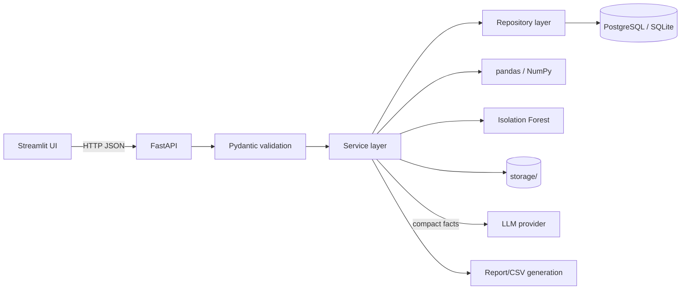
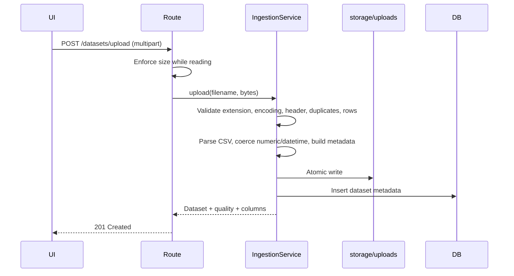
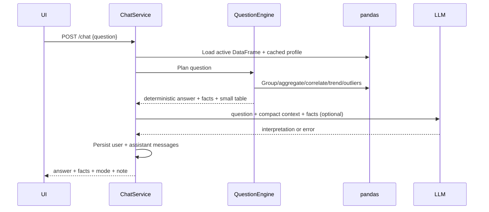
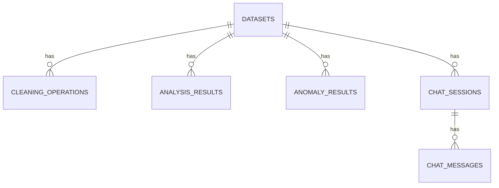
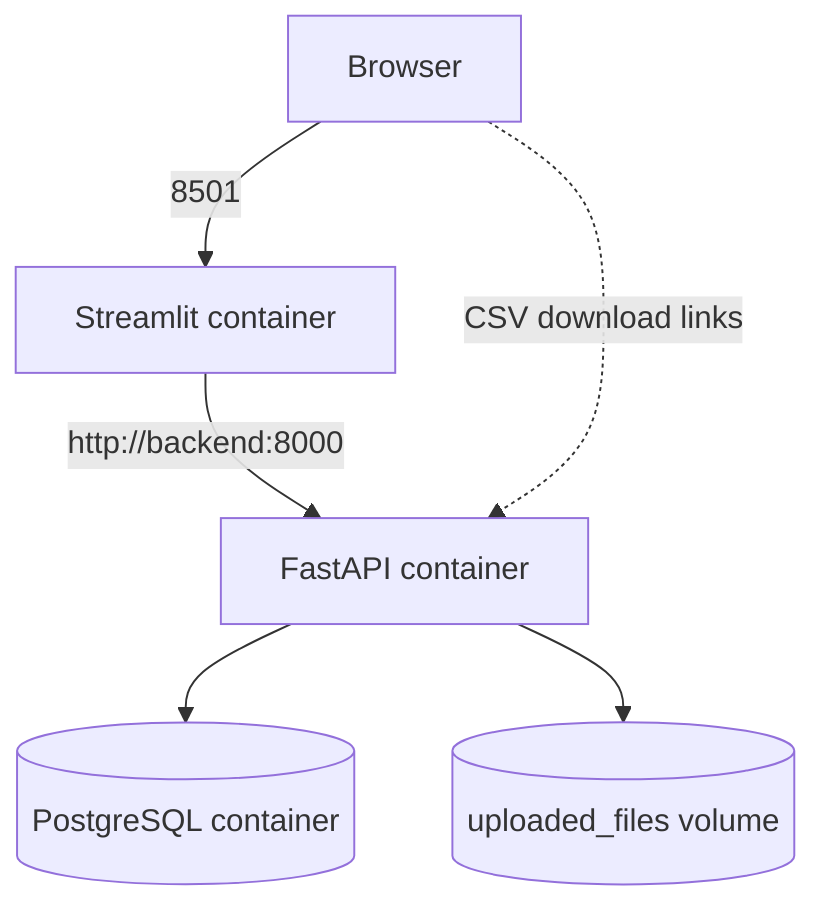

# Architecture

InsightFlow is a layered, single-user analytics application. This document explains the boundaries, request flows and the reasoning behind the main engineering decisions.

## 1. Goals and non-goals

**Goals**

- Turn an uploaded CSV into validated metadata, a reproducible cleaned copy, a statistical profile, ML anomaly results and grounded natural-language answers.
- Keep numerical correctness and data safety ahead of feature breadth.
- Make every layer independently testable.
- Run locally with either SQLite or PostgreSQL and containerize with Docker Compose.

**Non-goals (MVP)**

- Multi-user authentication, authorization or tenancy.
- Distributed processing, streaming ingestion or a job queue.
- Storing raw datasets in PostgreSQL.
- Letting an LLM execute SQL/Python or query the full dataset.

## 2. Components



| Layer | Location | Responsibility |
|---|---|---|
| Entry point | `backend/app/main.py` | App factory, CORS, request IDs, exception handlers, routers, health, SQLite schema bootstrap |
| Routers | `api/routes/` | HTTP semantics, dependencies, status codes; no heavy business logic |
| Schemas | `schemas/` | Request validation and response contracts |
| Services | `services/` | Cleaning, profiling, ML, assistant orchestration, reports, ingestion |
| Repositories | `repositories/` | Parameterized SQLAlchemy queries and persistence |
| Models | `models/` | Normalized tables, relationships, indexes |
| Utilities | `utils/` | Safe CSV parsing, metadata, JSON sanitization, path confinement |
| Frontend | `frontend/` | Presentation and API calls only |

## 3. Request flows

### 3.1 Upload



Failure at any point rolls back the database transaction and removes a partially written file.

### 3.2 Cleaning

1. Load the **original** file from `storage/uploads`.
2. Apply column drops, type conversions, duplicate removal, missing-value strategies, outlier handling and name normalization in a defined order.
3. Write `storage/processed/{dataset_id}_cleaned.csv` atomically.
4. Insert one `cleaning_operations` row per operation and update the dataset's active path.
5. Commit. On failure, roll back and delete the new file.

Cleaning never modifies the original, so a new recipe is reproducible and does not compound earlier transformations. Analytics and anomaly detection automatically use the cleaned copy once it exists.

### 3.3 Profiling and caching

`AnalyticsService.profile()` computes numeric/categorical/datetime statistics, correlations and time series. Results are stored in `analysis_results` as:

```json
{
  "cache_version": 3,
  "source_path": "/app/storage/processed/..._cleaned.csv",
  "source_mtime": 1763511062.12,
  "result": { "...": "profile payload" }
}
```

A cache entry is reused only when the path, file modification time and cache version match. Cleaning replaces the active file and therefore invalidates the profile. The `refresh=true` query parameter bypasses the cache explicitly.

### 3.4 Anomaly detection

1. Select numeric columns with non-null variation (or validate requested features).
2. Replace infinities with null, exclude rows where every feature is missing, median-impute remaining gaps.
3. Standardize features.
4. Fit `IsolationForest(n_estimators, contamination, random_state)`.
5. Convert `decision_function` into an intuitive score: `score = -decision_function` (higher = more unusual).
6. Rank flagged records, preserve row numbers and original values.
7. Persist a summary plus up to 2,000 flagged records.

No accuracy or precision metric is reported because the model is unsupervised and no ground-truth labels exist.

### 3.5 Assistant



The LLM never calculates the answer. If no provider is configured, or a timeout/rate limit/auth error occurs, the deterministic answer is returned with `mode = "calculations_only"` and a note.

## 4. Database design



Design choices:

- **String UUIDs** for datasets and chat sessions keep identifiers portable and URL-safe.
- **JSONB on PostgreSQL** for flexible analytical payloads; the same models use portable JSON on SQLite. The variant is declared once in `db/base.py`.
- **Foreign keys with `ON DELETE CASCADE`** plus ORM cascade ensure deleting a dataset removes operations, analyses, anomaly runs and conversations. Files are removed by the service.
- **Indexes** are added for dataset status, dataset/type lookups, anomaly ordering and chat session message lookup.
- **No binary file content** is stored in the database. Storage paths are validated to remain under `STORAGE_DIR`.
- **Migrations** are the source of truth for PostgreSQL. SQLite gets an automatic `create_all()` at startup for a frictionless local experience.

## 5. Security and reliability

| Risk | Mitigation |
|---|---|
| Path traversal | Filenames reduced to basenames; uploads stored under a generated ID; resolved paths must be inside `STORAGE_DIR`. |
| Malicious uploads | Extension check, size limit enforced before full buffering, null-byte/binary check, encoding fallback, header and duplicate-column validation, row limit. |
| SQL injection | SQLAlchemy expressions and bound parameters only; no raw SQL with user input. |
| Secret exposure | Keys come from environment variables; never logged or returned; `.env` ignored by Git and Docker context. |
| Stack-trace leakage | Central handlers return a stable envelope; unexpected exceptions are logged with a request ID and return a generic message. |
| External API failure | Timeouts, 429/401/403 handling, bounded prompt context and calculations-only fallback. |
| LLM misuse | No generated code/SQL execution; only aggregate facts are sent; prompt explicitly forbids invention and causation claims. |
| Untrusted filenames in UI | Rendered through escaped HTML helpers where user data is interpolated. |
| Large responses | Preview pagination; anomaly payload capped at 2,000 records; profile payload limited to summaries/top values. |
| Transaction consistency | Service-level commit/rollback; file cleanup after failed writes. |

Logging records request IDs, routes, status codes, durations and dataset metadata (IDs, row counts). It intentionally avoids dataset contents.

## 6. Frontend architecture

- `app.py` owns page configuration, global styles, sidebar dataset selection and navigation.
- Each page under `pages/` is a thin renderer that calls `InsightFlowClient`.
- `components/ui.py` provides the design system (cards, metrics, badges, callouts, formatting) and `components/charts.py` builds Plotly figures from API aggregates.
- The client translates network errors into `ApiError` objects with the backend's message/code, so pages display actionable states rather than stack traces.
- Session state holds only UI concerns: active dataset, chat session, current anomaly result and preview offset.
- No page calculates analytics locally; all numbers and chart data come from the API.

## 7. Testing strategy

- **Hermetic fixtures**: environment variables are set before importing the app, pointing to a temporary SQLite database and storage directory.
- **Schema reset** before each test guarantees isolation, including API tests and direct service tests.
- **Service-level tests** verify calculations precisely (means, medians, quartiles, correlations, outlier counts).
- **API tests** verify status codes, envelopes, cascades, downloads and persistence.
- **LLM tests** inject `httpx.MockTransport` to simulate success, timeouts, 429 and 401 without external calls. The assistant is additionally tested with fake provider objects to verify grounding and fallback.
- **Determinism**: fixed random seeds for Isolation Forest and sample data; no timing-dependent assertions.

## 8. Deployment topology



- PostgreSQL has a `pg_isready` health check.
- The backend entrypoint retries `alembic upgrade head` before starting Uvicorn.
- The frontend waits for a healthy backend.
- A named volume preserves uploads/processed files across container restarts.
- `PUBLIC_API_BASE_URL` separates container-to-container API traffic from browser-facing download links.

## 9. Tradeoffs and future work

- **Inline analytics** is simpler than a job queue; caching and isolated row limits keep the MVP responsive. Larger datasets would benefit from background jobs.
- **Local storage** keeps setup trivial; S3-compatible storage would be the next step for durability and signed access.
- **Single-user by design** avoids pretending authentication exists. A future identity layer can attach `owner_id` to datasets and enforce it in repositories/routes while services remain unchanged.
- **No labeled anomaly evaluation** is presented; adding labels would enable precision/recall reporting.
- **One LLM call per question** keeps behavior explainable; tool-calling could be added later but must route through the deterministic engine, not raw SQL.
